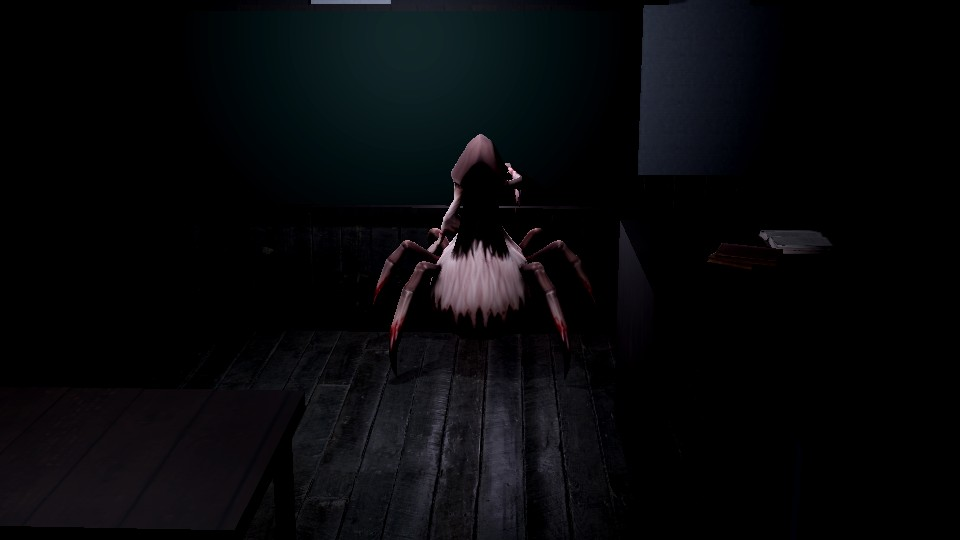

# Variável Oculta

Jogo educativo de suspense em 3D, feito em Godot 4.7. A protagonista, Yuko, acorda sozinha à noite em uma escola abandonada e só consegue sair resolvendo enigmas de Português, Matemática, Ciências, Geografia e Música. Em duas salas, professores transformados em monstros escutam cada passo.

O projeto é o resultado prático do trabalho "A gamificação como solução no processo de aprendizagem", da turma 3 de Análise e Desenvolvimento de Sistemas da EE José Maria Matosinho, em Campinas, 2026.



## Equipe

- **Beatriz Helena**: pesquisa
- **Ana Júlia Torres Reis**: personagens e animações no Blender
- **Ícaro Alves**: gamificação e pistas
- **Evillyn Rosa**: gestão do projeto e back end

## Jogar sem instalar nada (Windows)

1. Na página do repositório, abra **Releases** e baixe o arquivo `VariavelOculta_v6.2.1_Windows.zip`.
2. Descompacte a pasta inteira e dê dois cliques em `VariavelOculta.exe`. O `.exe` e o `.pck` precisam ficar juntos na mesma pasta.
3. Se o Windows mostrar "O Windows protegeu o computador", clique em **Mais informações** e depois em **Executar assim mesmo**. O aviso aparece porque o jogo não tem assinatura digital.

## Como abrir o projeto no Godot

1. Instale o [Godot 4.7](https://godotengine.org/download) (versão padrão, não a .NET).
2. No Godot, clique em **Importar**, escolha o arquivo `project.godot` desta pasta e abra o projeto.
3. Na primeira vez, o Godot importa as texturas e os modelos. Isso pode levar alguns minutos.
4. Aperte **F5** para jogar a partir do menu principal.

Para abrir direto em uma sala, use as cenas da pasta `scenes/apresentacao` com **Executar Cena Atual** (F6; em alguns notebooks, Fn + F6). O menu principal também tem a opção "Apresentação: ir para uma sala".

## Controles

| Tecla | Ação |
|---|---|
| W, A, S, D | Andar |
| Shift | Correr (faz mais barulho) |
| Ctrl | Agachar e se esconder embaixo das mesas |
| E | Interagir |
| J | Diário de pistas |
| M | Mapa |
| T | Telefone |
| Esc | Pausa |

## Como o jogo está organizado

```
assets/     modelos .glb, texturas, sons e fontes
data/       banco de dados do jogo em JSON (salas, pistas, enigmas, monstros, história)
scenes/     cena principal da escola, personagens, móveis, interface e cenas de apresentação
scripts/    código em GDScript (câmera, jogador, monstros, enigmas, história, salvamento)
tests/      testes automáticos
tools/      scripts que geram a história, o layout dos móveis e a malha de navegação
docs/       roteiro, relatórios de desenvolvimento e capturas
```

O banco de dados fica em `data/game_data.json` e `data/story.json`. Cada objeto da cena tem um id que aponta para o banco (por exemplo, `room_1.gaveta`), e o jogo confere essas ligações ao abrir.

Os textos da história ficam em `tools/story_content.py`. Depois de mudar algum texto, rode:

```
python3 tools/build_story.py
```

## Testes automáticos

Os testes abrem o jogo sem janela e jogam sozinhos: andam até os objetos, digitam respostas, se escondem dos monstros e conferem se tudo aconteceu como devia. Para rodar um teste:

```
godot --headless --fixed-fps 60 --path . --script res://tests/historia_completa_test.gd
```

No fim aparece `RESULTADO: X ok, 0 falhas`.

## Gerar o executável

O arquivo `export_presets.cfg` já tem a configuração para Windows. No Godot, vá em **Projeto → Exportar**, escolha **Windows** e clique em **Exportar Projeto** (na primeira vez o Godot pede para baixar os modelos de exportação). Pelo terminal:

```
godot --headless --path . --export-release "Windows" build/windows/VariavelOculta.exe
```

## Créditos

- Personagens modelados e animados no Blender pela equipe.
- Texturas de chão e parede da [Poly Haven](https://polyhaven.com) (CC0).
- Fontes IM Fell English e Caveat, sob a licença SIL Open Font License (os textos das licenças estão em `assets/fonts`).
